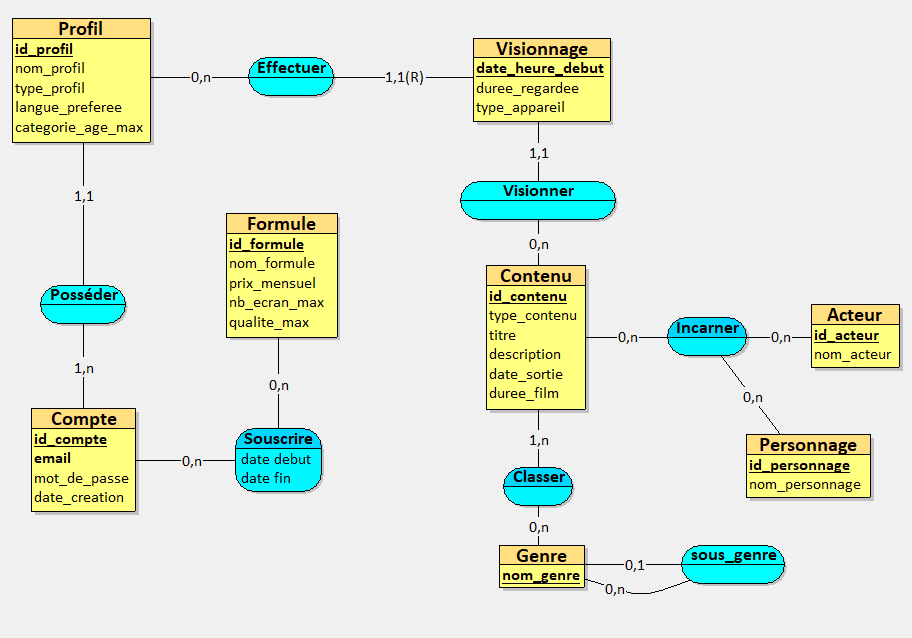
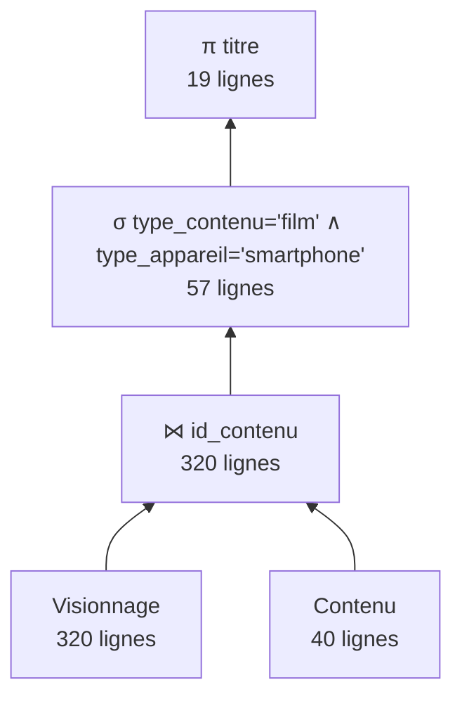
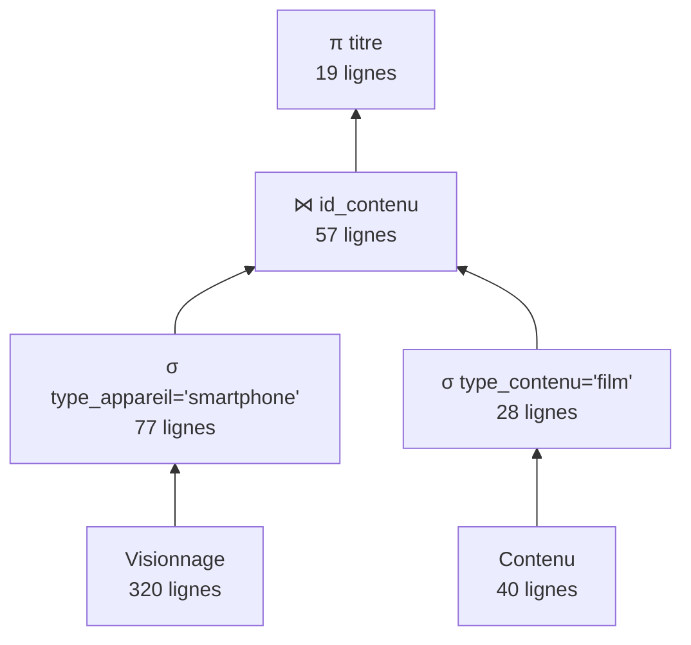
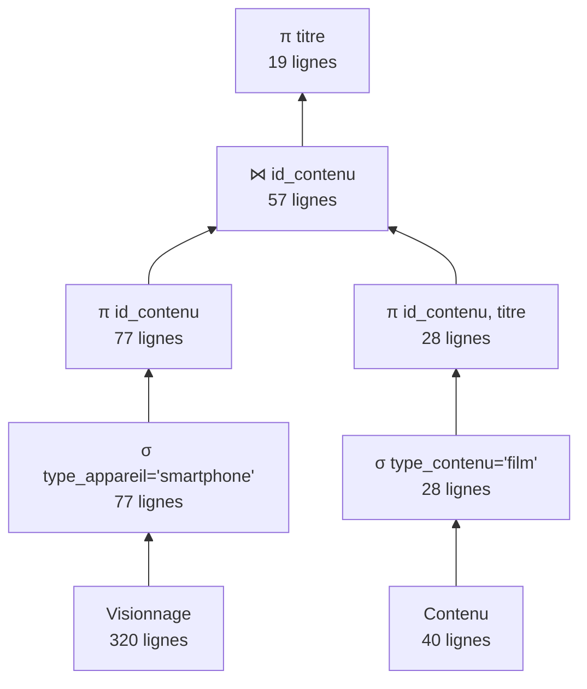

# Mini-projet BDD - Plateforme de streaming (type Netflix)

**Module :** TI503N - Bases de données 1 : Concepts de base (Efrei)
**Binôme :** [BANGFOFACK Bryand Rayol] et [Orlane ACACHA]
**Rendu :** Partie 1 (analyse des besoins + MCD), à rendre le 16/10/26

---

## 1. Présentation

Ce projet applique la méthode MERISE pour concevoir la base de données d'une plateforme de streaming vidéo par abonnement, inspirée de Netflix, Disney+ et Amazon Prime Video.

La partie 1 couvre :
1. L'analyse des besoins, réalisée avec une IA générative qui joue le rôle de l'entreprise
2. La conception du MCD

## 2. Prompt utilisé

Le prompt final est construit à partir de la base de prompt fournie (framework RICARDO). Seules les zones à compléter ont été remplies (domaine, activité, exemples, données collectées, références). Il est aussi disponible dans le fichier [`prompt.md`](prompt.md).

```
Tu travailles dans le domaine du streaming vidéo à la demande. Ton entreprise a comme activité de proposer, par abonnement mensuel, un catalogue de films et de séries accessible sur internet depuis plusieurs appareils. C’est une entreprise comme Netflix, Disney+ ou Amazon Prime Video. Les données ont été collectées sur : les formules d'abonnement, les comptes clients et leurs profils, le catalogue (films, séries, genres et sous-genres, saisons, épisodes), les acteurs et les personnages qu'ils incarnent, et le visionnage des contenus par les profils. Inspire-toi du site web suivant : https://www.netflix.com/fr/ et de son centre d'aide https://help.netflix.com/fr.
Ton entreprise veut appliquer MERISE pour concevoir un système d'information. Tu es chargé de la partie analyse, c’est-à-dire de collecter les besoins auprès de l’entreprise. Elle a fait appel à un étudiant en ingénierie informatique pour réaliser ce projet, tu dois lui fournir les informations nécessaires pour qu’il applique ensuite lui-même les étapes suivantes de conception et développement de la base de données. 
D’abord, établis les règles de gestions des données de ton entreprise, sous la forme d'une liste à puce. Elle doit correspondre aux informations que fournit quelqu’un qui connaît le fonctionnement de l’entreprise, mais pas comment se construit un système d’information.
Ensuite, à partir de ces règles, fournis un dictionnaire de données brutes avec les colonnes suivantes, regroupées dans un tableau : signification de la donnée, type, taille en nombre de caractères ou de chiffres. Il doit y avoir entre 25 et 35 données. Il sert à fournir des informations supplémentaires sur chaque donnée (taille et type) mais sans a priori sur comment les données vont être modélisées ensuite.
Fournis donc les règles de gestion et le dictionnaire de données.
```

## 3. IA utilisée et historique des essais

| Essai | IA utilisée | Prompt | Résultat |
|---|---|---|---|
| 1 | Autre IA générative (ChatGPT) | Version 1 (mentionnait des « recommandations entre profils ») | 35 données, mais aucune association récursive dans les règles (voir section 6) |
| 2 (final) | Claude (Anthropic) | Version 2 (ci-dessus, données collectées reformulées) | Résultat conservé, présenté aux sections 4 et 5 |

## 4. Règles de gestion (obtenues auprès de l'IA)

### A. Abonnements et comptes clients

- L'entreprise propose plusieurs formules d'abonnement (par exemple Standard avec publicité, Standard, Premium).
- Chaque formule a un nom, un prix mensuel, un nombre maximal d'écrans pouvant regarder en même temps et une qualité vidéo maximale.
- Une même formule peut être souscrite par de nombreux clients.
- Pour utiliser le service, un client crée un compte avec une adresse e-mail (unique) et un mot de passe. La date de création du compte est conservée.
- À un instant donné, un compte a une seule formule active. Un client peut changer de formule : l'entreprise garde l'historique des abonnements successifs du compte, avec leurs dates de début et de fin.
- Un abonnement est soit actif, soit suspendu, soit résilié.

### B. Profils

- Un compte contient de 1 à 5 profils. Un profil appartient à un seul compte.
- Chaque profil a un nom (unique au sein d'un même compte) et une langue préférée.
- Un profil est soit standard, soit jeunesse.
- Chaque profil a une catégorie d'âge maximale des contenus autorisés (par exemple 7+, 12+, 16+, 18+).

### C. Catalogue

- Le catalogue contient des contenus : des films et des séries.
- Chaque contenu a un titre, une description et une date de sortie.
- Un film a une durée en minutes.
- Un contenu appartient à un ou plusieurs genres.
- Les genres sont organisés en hiérarchie : un genre peut être décomposé en sous-genres (par exemple Comédie, puis Comédie romantique). Un sous-genre dépend d'un seul genre principal. Un genre principal n'a pas de genre parent.
- Une série est composée d'une ou plusieurs saisons, numérotées 1, 2, 3... La numérotation des saisons est propre à chaque série. Une saison n'existe pas sans sa série.
- Une saison contient plusieurs épisodes, numérotés à partir de 1 dans chaque saison. Un épisode a un titre et une durée en minutes. Un épisode n'existe pas sans sa saison. Deux séries différentes peuvent avoir chacune un épisode numéro 1.

### D. Acteurs et personnages

- Un contenu fait intervenir plusieurs acteurs. Un acteur peut jouer dans plusieurs contenus.
- Dans un contenu, un acteur incarne un personnage. L'entreprise doit pouvoir savoir quel acteur joue quel personnage dans quel contenu.
- Un même personnage peut apparaître dans plusieurs contenus (suites, spin-offs) et être incarné par des acteurs différents d'un contenu à l'autre.

### E. Visionnage

- Un profil peut regarder de nombreux contenus. Un même contenu peut être regardé par de nombreux profils.
- Chaque visionnage concerne un film ou un épisode d'une série.
- Pour chaque visionnage, l'entreprise enregistre la date et l'heure de début, la durée effectivement regardée et le type d'appareil utilisé (téléviseur, ordinateur, smartphone, tablette, console).
- Un profil peut regarder plusieurs fois le même film ou le même épisode, à des moments différents.
- Le nombre d'écrans qui regardent en même temps ne doit pas dépasser la limite de la formule du compte.

> **Note :** les règles sur les saisons et les épisodes (section C, deux dernières puces) et la mention « ou un épisode » de la règle E ne sont pas modélisées dans le MCD (voir sections 6 et 7).

## 5. Dictionnaire de données (obtenu auprès de l'IA)

La dernière colonne indique si la donnée est retenue dans le MCD (voir section 6).

| N° | Signification de la donnée | Type | Taille | Dans le MCD |
|---:|---|---|---|---|
| 1 | Identifiant de la formule d'abonnement | Entier | 5 chiffres | Oui |
| 2 | Nom de la formule d'abonnement | Texte | 30 caractères | Oui |
| 3 | Prix mensuel de la formule | Décimal | 5 chiffres dont 2 décimales | Oui |
| 4 | Nombre maximal d'écrans simultanés | Entier | 1 chiffre | Oui |
| 5 | Qualité vidéo maximale | Texte | 10 caractères | Oui |
| 6 | Identifiant du compte client | Entier | 10 chiffres | Oui |
| 7 | Adresse e-mail du compte | Texte | 254 caractères | Oui |
| 8 | Mot de passe du compte | Texte | 255 caractères | Oui |
| 9 | Date de création du compte | Date | 10 caractères | Oui |
| 10 | Date de début de l'abonnement | Date | 10 caractères | Oui |
| 11 | Date de fin de l'abonnement | Date | 10 caractères | Oui |
| 12 | État de l'abonnement (actif, suspendu, résilié) | Texte | 15 caractères | Oui |
| 13 | Identifiant du profil | Entier | 10 chiffres | Oui |
| 14 | Nom du profil | Texte | 30 caractères | Oui |
| 15 | Type de profil (standard ou jeunesse) | Texte | 10 caractères | Oui |
| 16 | Langue préférée du profil | Texte | 5 caractères | Oui |
| 17 | Catégorie d'âge maximale du profil | Texte | 5 caractères | Oui |
| 18 | Identifiant du contenu | Entier | 10 chiffres | Oui |
| 19 | Type de contenu (film ou série) | Texte | 5 caractères | Oui |
| 20 | Titre du contenu | Texte | 150 caractères | Oui |
| 21 | Description du contenu | Texte | 1000 caractères | Oui |
| 22 | Date de sortie du contenu | Date | 10 caractères | Oui |
| 23 | Durée du film en minutes | Entier | 3 chiffres | Oui |
| 24 | Nom du genre | Texte | 40 caractères | Oui |
| 25 | Numéro de la saison | Entier | 2 chiffres | Non |
| 26 | Numéro de l'épisode dans la saison | Entier | 3 chiffres | Non |
| 27 | Titre de l'épisode | Texte | 150 caractères | Non |
| 28 | Durée de l'épisode en minutes | Entier | 3 chiffres | Non |
| 29 | Identifiant de l'acteur | Entier | 10 chiffres | Oui |
| 30 | Nom complet de l'acteur | Texte | 100 caractères | Oui |
| 31 | Identifiant du personnage | Entier | 10 chiffres | Oui |
| 32 | Nom du personnage | Texte | 100 caractères | Oui |
| 33 | Date et heure de début du visionnage | Date/heure | 19 caractères | Oui |
| 34 | Durée regardée en minutes | Entier | 4 chiffres | Oui |
| 35 | Type d'appareil utilisé | Texte | 20 caractères | Oui |

## 6. Vérification et problèmes rencontrés

**Vérifications faites sur le résultat final (essai 2) :**
- Nombre de données : 35 (entre 25 et 35 demandé)
- Colonnes demandées présentes : signification, type, taille
- Règles écrites en langage métier, sans vocabulaire de modélisation
- Dictionnaire sans clés ni tables (données brutes)

**Problèmes relevés sur l'essai 1 :**
- La formulation « recommandations entre profils » a été comprise comme des recommandations faites par le système. Aucune règle n'exprimait qu'un profil en recommande à un autre, donc pas d'association récursive.
- La donnée « durée de l'épisode ou du contenu » mélangeait deux notions.
- Des règles mentionnaient des notions sans donnée correspondante (appareils, avatar, évaluations, zones géographiques).

**Corrections apportées pour l'essai 2 :**
- Prompt modifié (version 2) : la liste des données collectées mentionne désormais les genres et sous-genres, les personnages incarnés et les visionnages, et ne parle plus de recommandations.
- Le prompt a été re-soumis en entier.

**Simplification décidée lors de la modélisation :**
- Un épisode étant lui-même un contenu regardable, une entité ÉPISODE à côté de CONTENU créait une ambiguïté (le visionnage devait pointer soit vers un contenu, soit vers un épisode).
- Nous avons donc retiré la notion de saison et d'épisode du MCD. Les données n° 25 à 28 (numéro de saison, numéro d'épisode, titre de l'épisode, durée de l'épisode) ne sont pas retenues.
- Le MCD contient 31 des 35 données du dictionnaire. Les règles correspondantes (section 4, partie C, deux dernières puces, et mention « ou un épisode » de la règle E) ne sont pas modélisées.
- Un contenu de type « série » est donc représenté comme un seul contenu, sans détail des saisons ni des épisodes.

## 7. MCD

Le MCD a été réalisé avec **Looping**. Fichier source : [`mcd/netflix.loo`](mcd/netflix.loo)



### Éléments de modélisation avancée

| Élément | Où | Justification |
|---|---|---|
| Association récursive | GENRE (association SOUS_GENRE) | Un genre peut avoir des sous-genres (Comédie, puis Comédie romantique) |
| Entité faible / forte | VISIONNAGE dépend de PROFIL | Un visionnage n'existe pas sans le profil qui l'a effectué, il est identifié par sa date et heure de début relativement au profil |
| Association ternaire | INCARNER (ACTEUR, CONTENU, PERSONNAGE) | Un personnage peut être joué par des acteurs différents selon le contenu |

### Entités

| Entité | Identifiant | Autres attributs |
|---|---|---|
| FORMULE | id_formule | nom_formule, prix_mensuel, nb_ecrans_max, qualite_max |
| COMPTE | id_compte | email, mot_de_passe, date_creation |
| PROFIL | id_profil | nom_profil, type_profil, langue_preferee, categorie_age_max |
| CONTENU | id_contenu | type_contenu, titre, description, date_sortie, duree_film |
| GENRE | nom_genre | |
| ACTEUR | id_acteur | nom_acteur |
| PERSONNAGE | id_personnage | nom_personnage |
| VISIONNAGE (faible) | date_heure_debut, relatif à PROFIL | duree_regardee, type_appareil |

### Associations et cardinalités

| Association | Patte 1 | Patte 2 | Attributs |
|---|---|---|---|
| POSSEDER | PROFIL (1,1) | COMPTE (1,N) | |
| SOUSCRIRE | COMPTE (0,N) | FORMULE (0,N) | date_debut, date_fin, etat |
| CLASSER | CONTENU (1,N) | GENRE (0,N) | |
| SOUS_GENRE (récursive) | GENRE, rôle sous-genre (0,1) | GENRE, rôle genre parent (0,N) | |
| INCARNER (ternaire) | ACTEUR (0,N) | CONTENU (0,N) et PERSONNAGE (0,N) | |
| EFFECTUER | VISIONNAGE (1,1), identifiant relatif | PROFIL (0,N) | |
| VISIONNER | VISIONNAGE (1,1) | CONTENU (0,N) | |

### Choix de modélisation

- L'historique des abonnements est porté par l'association SOUSCRIRE (date_debut, date_fin, etat).
- Le visionnage est enregistré au niveau du contenu (film ou série).
- Les saisons et épisodes ne sont pas modélisés (voir section 6).
- Les 31 données retenues du dictionnaire sont toutes présentes dans le MCD (les données 10, 11 et 12 sont sur l'association SOUSCRIRE).

### Contraintes non représentables dans le MCD

- Un compte contient au maximum 5 profils.
- À un instant donné, un compte a une seule formule active.
- Le nom d'un profil est unique au sein d'un même compte.
- L'adresse e-mail d'un compte est unique.
- Le nombre d'écrans qui regardent en même temps ne dépasse pas la limite de la formule du compte.

## 8. Organisation du dépôt

```
.
├── README.md    Documentation du projet
├── prompt.md    Prompt final utilisé
└── mcd/
    └── netflix.png    Image du MCD
    └──fichier source MCD
```


## 9. Étape 3 — MLD et MPD

### MLD

Déduit du MCD avec les règles de transformation (Looping). Clés primaires **en gras**, clés étrangères précédées de `#`.

- Formule = (**id_formule**, nom_formule, prix_mensuel, nb_ecran_max, qualite_max)
- Compte = (**id_compte**, email, mot_de_passe, date_creation)
- Souscrire = (**#id_compte**, **#id_formule**, **date_debut**, date_fin, etat)
- Profil = (**id_profil**, nom_profil, type_profil, langue_preferee, categorie_age_max, #id_compte)
- Contenu = (**id_contenu**, type_contenu, titre, description, date_sortie, duree_film)
- Genre = (**nom_genre**, #nom_genre_parent)
- Classer = (**#id_contenu**, **#nom_genre**)
- Acteur = (**id_acteur**, nom_acteur)
- Personnage = (**id_personnage**, nom_personnage)
- Incarner = (**#id_contenu**, **#id_acteur**, **#id_personnage**)
- Visionnage = (**#id_profil**, **date_heure_debut**, duree_regardee, type_appareil, #id_contenu)

**Règles de transformation appliquées :**
- **Associations (1,1) — (x,n), comme POSSEDER et VISIONNER :** la clé de l'entité côté n migre comme clé étrangère, ce qui donne `#id_compte` dans Profil et `#id_contenu` dans Visionnage.
- **Associations (x,n) — (x,n), comme SOUSCRIRE, CLASSER et INCARNER (ternaire) :** elles deviennent une table, dont la clé primaire est composée des clés des entités liées.
- **Association récursive SOUS_GENRE (0,1) :** elle donne la clé étrangère `#nom_genre_parent` dans Genre, qui fait référence à `nom_genre`.
- **Entité faible VISIONNAGE, identifiée relativement à PROFIL :** sa clé primaire est `(id_profil, date_heure_debut)`.
- **Choix pour Souscrire :** on a ajouté `date_debut` à la clé primaire. Un compte peut ainsi reprendre plus tard une formule qu'il avait déjà eue, et l'historique des abonnements est conservé (règle A).

### MPD

- `1_creation.sql` : création des tables, clés primaires et clés étrangères. Toutes les clés étrangères ont `ON DELETE CASCADE ON UPDATE CASCADE`, sauf le genre parent, qui a `ON DELETE SET NULL`.
- `2_contraintes.sql` : contraintes de validation tirées des règles de gestion :
  - valeurs non vides ;
  - valeurs autorisées avec `IN` et intervalles avec `BETWEEN` ;
  - format de l'e-mail avec `LIKE` ;
  - unicité du nom de profil dans un compte ;
  - cohérence entre l'état et la date de fin, entre un film et sa durée, entre un profil jeunesse et sa catégorie d'âge.
- Les règles « 5 profils maximum par compte » et « une seule formule active à la fois » ne peuvent pas s'écrire avec un `CHECK`, parce qu'il faudrait compter des lignes. Elles restent des contraintes non représentables (voir section 7).

## 10. Étape 4 — Insertion des données

Les données ont été générées automatiquement avec une IA générative (**Claude**, Anthropic), à partir d'un prompt construit sur le modèle de celui du TP1.

**Ce qu'on a gardé du prompt du TP1 :**
- le modèle relationnel complet, avec les clés primaires indiquées après chaque relation et les clés étrangères repérées par `#` ;
- le nombre de lignes attendu pour chaque table ;
- l'ordre de remplissage : d'abord les tables sans clé étrangère, ensuite les tables dont les clés étrangères pointent vers des tables déjà remplies ;
- la liste des contraintes de validation, copiée telle quelle en SQL ;
- la demande de noms variés et mixtes, et un script SQL prêt à être exécuté.

**Ce qu'on a adapté à notre BD :**
- les maisons du TP1 sont remplacées par les 3 formules citées dans nos règles de gestion (Standard avec publicité, Standard, Premium), dont les caractéristiques sont imposées ;
- on reprend le vocabulaire de nos règles de gestion et du dictionnaire de données : profils `standard` ou `jeunesse`, catégories d'âge de `7+` à `18+`, état de l'abonnement (`actif`, `suspendu`, `résilié`) et types d'appareil ;
- on a ajouté des règles de cohérence que les `CHECK` ne peuvent pas exprimer :
  - un visionnage a lieu après la création du compte et après la sortie du contenu ;
  - la durée regardée ne dépasse pas la durée du film ;
  - les profils jeunesse ne regardent que de l'Animation ou du contenu Famille ;
  - un compte a au plus une souscription active ou suspendue à la fois ;
  - un même personnage apparaît dans plusieurs contenus avec des acteurs différents ;
- on demande volontairement quelques cas « vides » (contenus jamais vus, profils inactifs, comptes qui ont tout résilié) pour que les jointures externes et les `NOT EXISTS` de l'étape 5 renvoient des résultats ;
- les genres principaux sont insérés avant les sous-genres, à cause de l'auto-référence `nom_genre_parent`.

Le prompt est dans [`prompt_insertion.txt`](prompt_insertion.txt) et le résultat dans [`3_insertion.sql`](3_insertion.sql).

| Table | Lignes |
|---|---|
| Formule | 3 |
| Compte | 30 |
| Souscrire | 41 (23 actives, 3 suspendues, 15 résiliées) |
| Profil | 90 (dont 23 jeunesse) |
| Contenu | 40 (28 films, 12 séries) |
| Genre | 16 (8 principaux + 8 sous-genres) |
| Classer | 84 |
| Acteur | 40 |
| Personnage | 60 |
| Incarner | 104 |
| Visionnage | 320 |

---

## 11. Étape 5 — Interrogation de la BD

### Scénario d'utilisation

**Utilisateur :** le ou la **responsable Stratégie contenus & Marketing** de la plateforme.

**Contexte :** l'équipe prépare la **campagne de fin d'année**. La personne interroge la base pour :

1. **Choisir les contenus à mettre en avant :** les nouveautés (films sortis depuis 2022), les contenus les plus regardés, le casting des séries pour les visuels, les contenus « multi-écrans » vus sur téléviseur et sur smartphone.
2. **Cibler les supports et les langues :** les appareils les plus utilisés et les langues préférées des profils, pour savoir où diffuser la campagne et dans quelles langues la traduire.
3. **Relancer les abonnés perdus :** les comptes qui ont tout résilié, pour une campagne « Revenez chez nous », les souscriptions suspendues à surveiller, et les profils qui n'ont encore rien regardé.
4. **Faire monter en gamme :** les comptes familles (4 profils ou plus) et les comptes en formule Standard ou Standard avec publicité qui regardent plus que certains comptes Premium, pour leur proposer le passage en Premium. Elle suit aussi le revenu mensuel par formule.
5. **Valoriser le catalogue :** les contenus Animation réellement regardés par les profils jeunesse, et les contenus jamais visionnés, à remettre en avant ou à retirer.

Chaque requête de [`4_interrogation.sql`](4_interrogation.sql) est précédée d'un commentaire qui indique la donnée recherchée. On a écrit 28 requêtes :

| Type | Requêtes |
|---|---|
| Projections et sélections (tri, `DISTINCT`, `LIKE`, `IN`, `BETWEEN`) | 1.1 à 1.7 |
| Agrégations (`COUNT`, `SUM`, `AVG`, `MIN`, `MAX`, `GROUP BY`, `HAVING`) | 2.1 à 2.6 |
| Jointures (interne, externe gauche, auto-jointure, multiples) | 3.1 à 3.7 |
| Requêtes imbriquées (`NOT EXISTS`, `IN`, `ALL`, `ANY`, `NOT IN`, `EXISTS`) | 4.1 à 4.7 |
| Requête étudiée ci-dessous (plans d'exécution) | 5 |

---

### Étude des plans d'exécution

**Requête étudiée :** les titres des films regardés sur smartphone (requête 5 du fichier).

```sql
SELECT DISTINCT ct.titre
FROM Visionnage v
JOIN Contenu ct ON ct.id_contenu = v.id_contenu
WHERE ct.type_contenu = 'film'
  AND v.type_appareil = 'smartphone';
```

Elle utilise **3 opérateurs** de l'algèbre relationnelle :

- la **sélection** σ ;
- la **jointure** ⋈ ;
- la **projection** π.

En algèbre relationnelle :

π<sub>titre</sub> ( σ<sub>type_contenu='film' ∧ type_appareil='smartphone'</sub> ( Visionnage ⋈<sub>id_contenu</sub> Contenu ) )

**Cardinalités mesurées sur notre base :**

| Ensemble | Lignes |
|---|---|
| Visionnage | 320 |
| Contenu | 40 |
| σ<sub>type_appareil='smartphone'</sub>(Visionnage) | 77 |
| σ<sub>type_contenu='film'</sub>(Contenu) | 28 |
| Visionnage ⋈ Contenu | 320 (chaque visionnage concerne un seul contenu) |
| après la sélection film ∧ smartphone | 57 |
| après la projection sur titre (sans doublon) | 19 |

**Modèle de coût :**

- une sélection ou une projection sur *n* lignes coûte *n* instructions, car chaque ligne est lue une fois ;
- une jointure par boucles imbriquées entre *n₁* et *n₂* lignes coûte *n₁ × n₂* instructions, car chaque couple de lignes est comparé.

#### Plan 1 : jointure d'abord, sélection ensuite (plan naïf)



| Étape | Calcul | Instructions |
|---|---|---|
| Visionnage ⋈ Contenu | 320 × 40 | 12 800 |
| σ film ∧ smartphone | 320 | 320 |
| π titre | 57 | 57 |
| **Total** | | **13 177** |

#### Plan 2 : sélections descendues avant la jointure



| Étape | Calcul | Instructions |
|---|---|---|
| σ smartphone (Visionnage) | 320 | 320 |
| σ film (Contenu) | 40 | 40 |
| ⋈ | 77 × 28 | 2 156 |
| π titre | 57 | 57 |
| **Total** | | **2 573** |

#### Plan 3 : sélections et projections descendues



| Étape | Calcul | Instructions |
|---|---|---|
| σ smartphone | 320 | 320 |
| σ film | 40 | 40 |
| π id_contenu | 77 | 77 |
| π id_contenu, titre | 28 | 28 |
| ⋈ | 77 × 28 | 2 156 |
| π titre | 57 | 57 |
| **Total** | | **2 678** |

#### Conclusion

| Plan | Instructions |
|---|---|
| Plan 1 (jointure d'abord) | 13 177 |
| **Plan 2 (sélections d'abord)** | **2 573** |
| Plan 3 (sélections + projections d'abord) | 2 678 |

Le **plan 2 est le plan optimisé**. Il demande environ **5 fois moins d'instructions** que le plan naïf (2 573 contre 13 177).

- **Pourquoi le plan 2 gagne :** la jointure est l'opération la plus coûteuse, puisque son coût est le produit des tailles. En faisant les sélections avant, on joint 77 × 28 lignes au lieu de 320 × 40. C'est la règle d'optimisation : *descendre les sélections le plus bas possible dans l'arbre*.
- **Pourquoi le plan 3 ne fait pas mieux :** descendre aussi les projections ne réduit pas le nombre de lignes, seulement le nombre de colonnes. Avec notre modèle de coût, cela ajoute 105 instructions de lecture. En pratique, le plan 3 peut quand même être intéressant sur de très grosses tables, parce que les lignes manipulées sont plus légères en mémoire. Mais au sens du nombre d'instructions, le plan 2 reste le meilleur.
